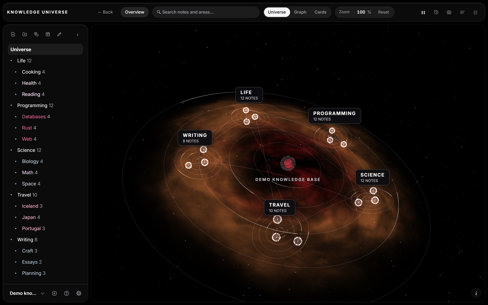
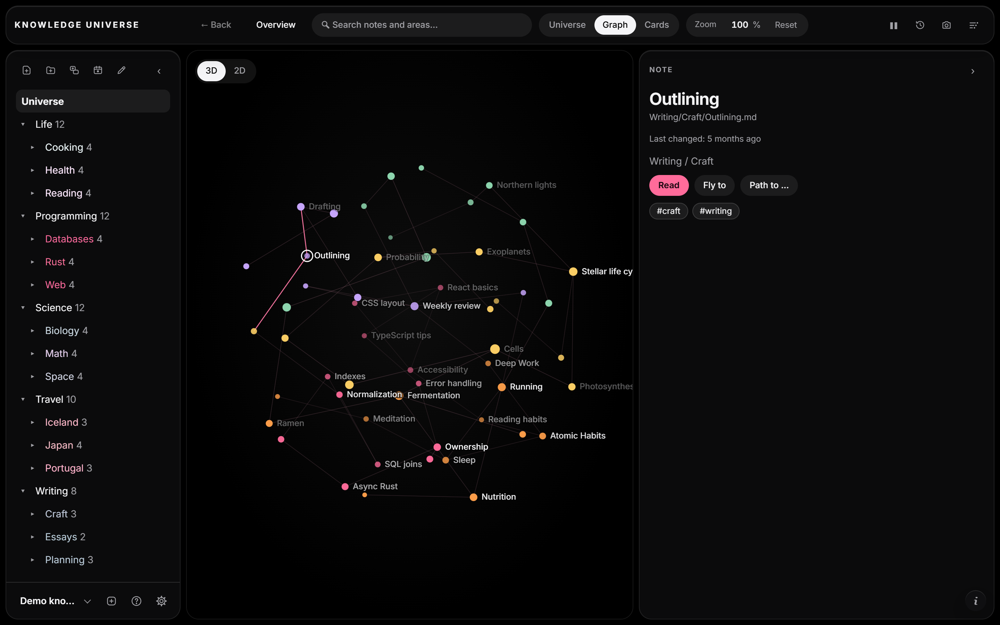
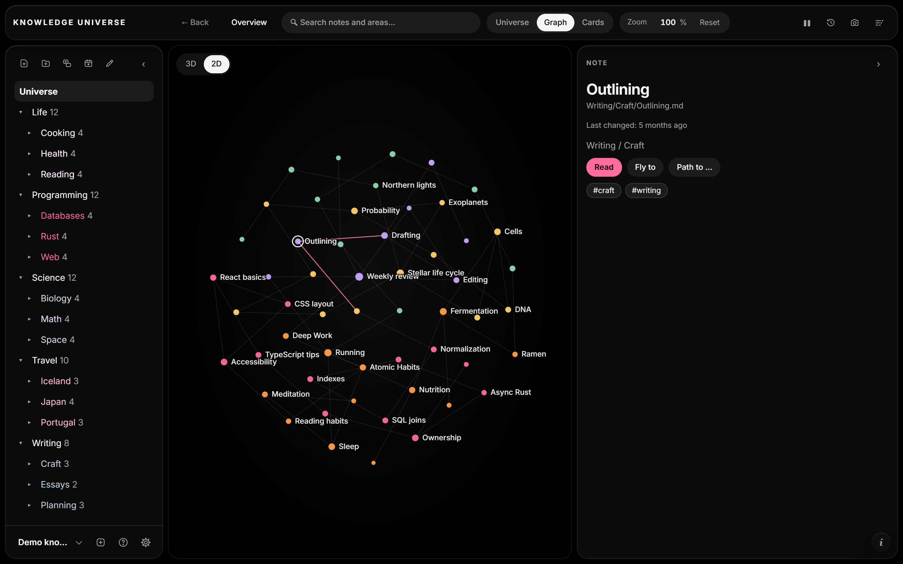
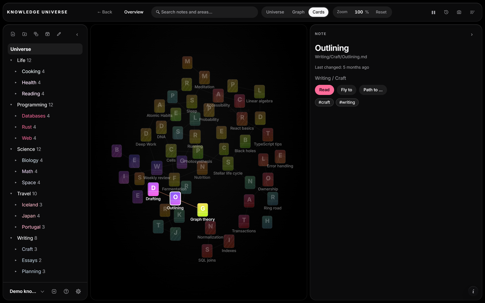
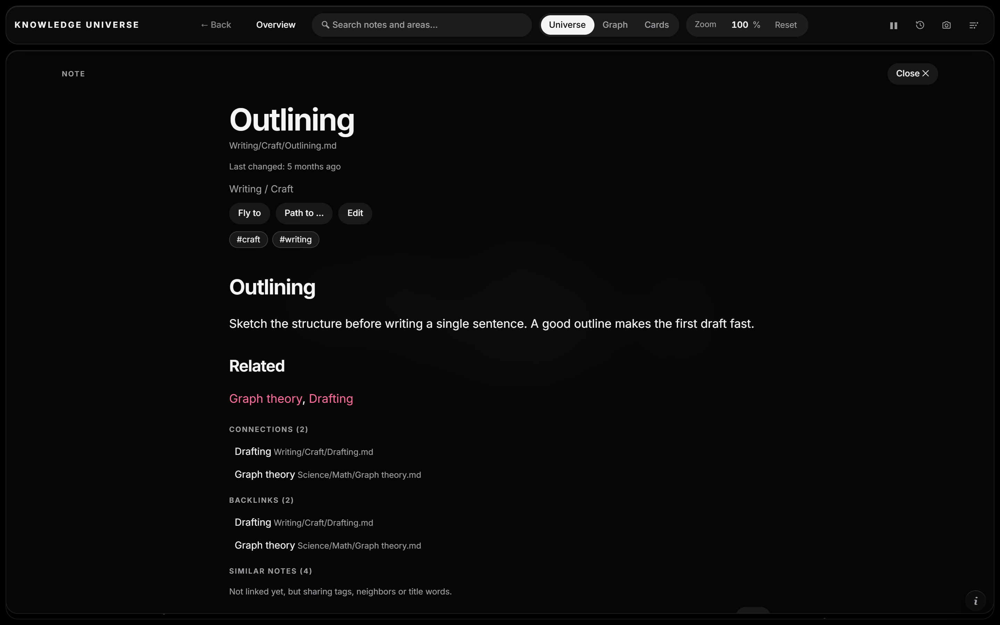
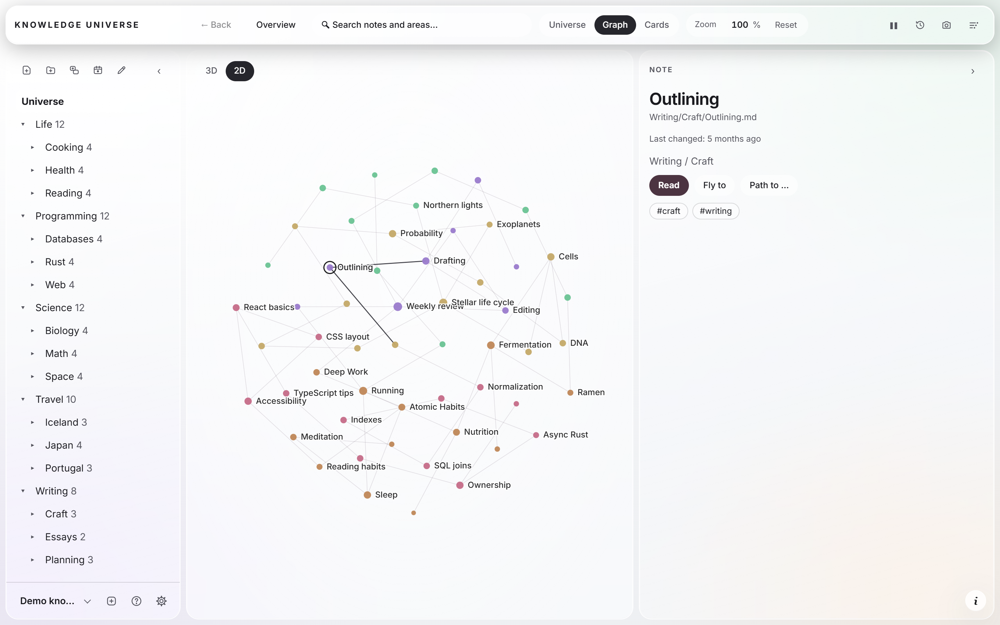
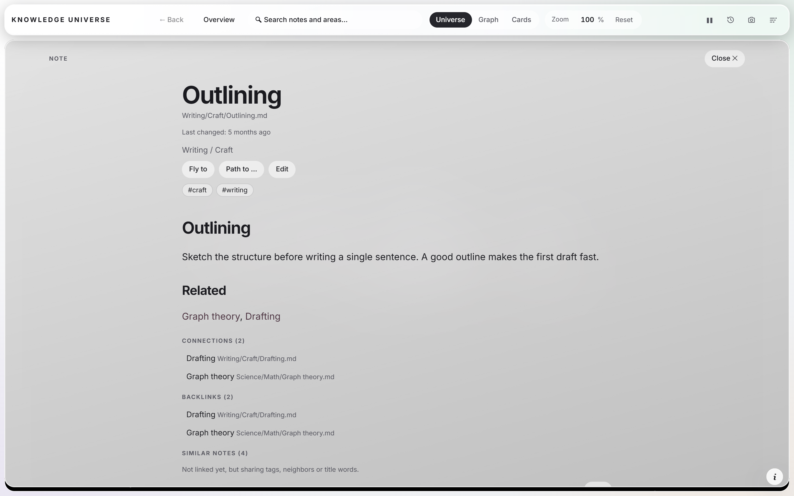

# Knowledge Universe

Your Markdown notes as a 3D universe you can fly through. Folders become galaxies and planets, notes become stars, links become connections.

**Free, for good. No ads, no accounts, no tracking.**

  

## Download

| Platform | File | Folder |
| --- | --- | --- |
| Windows 10 / 11 (64-bit) | `KnowledgeUniverse_1.0.0_x64-setup.exe` (installer) | [`win/`](win/) |
| Windows, no installation | `KnowledgeUniverse.exe` (portable) | [`win/`](win/) |
| macOS 11 or newer (Apple Silicon and Intel) | `KnowledgeUniverse_1.0.0_universal.dmg` (disk image) | [`mac/`](mac/) |

Installation steps, checksums and the Windows security prompt are explained in [`win/README.md`](win/README.md). For the Mac, the installation and the first start of the app (it is not notarized by Apple) are explained in [`mac/README.md`](mac/README.md).

## Screenshots

| | |
| --- | --- |
|  |  |
|  |  |
|  |  |

## What it does

- **Universe view:** fly through your notes in 3D. Double-click to enter a galaxy, click a star to read the note.
- **Graph view:** all notes and links as a graph, in 3D or flat 2D. Colors, lines and forces are adjustable, with a live preview.
- **Cards view:** notes as floating cards with link lines.
- **Canvas:** boards for free arranging of notes and text.
- **Read and write:** open, create, edit, move and delete notes, folders and canvases. Wiki links (`[[Note]]`) and Markdown links work.
- **Find your way:** search, filters by area, tag and health (orphaned, dead end, forgotten), saved views, shortest path between two notes, similar notes with one-click linking, link previews on hover.
- **Capture quickly:** today's note (`Alt+T`, on the Mac `Option+T`) and quick capture into an inbox note (`Ctrl+Shift+N`, on the Mac `Cmd+Shift+N`).
- **Time travel:** watch your knowledge base grow by the date of last change.
- **Export:** save the current view as an image (PNG) or a short video.
- **Looks:** dark and light mode, adjustable colors, fonts and reading width.
- **Languages:** English, German and Turkish (Options, Language). English is the default.

## Your notes stay yours

- Your notes are plain Markdown files in a normal folder. The app only changes a file when you ask it to.
- Everything runs on your computer. The app does not collect or send any data and makes no network connections of its own. Links you click open in your browser.
- Settings are stored locally on your device.

## Requirements

- **Windows:** Windows 10 or 11, 64-bit. The Microsoft Edge WebView2 runtime is needed (preinstalled on Windows 11; on Windows 10 the installer downloads it from Microsoft if it is missing).
- **macOS:** macOS 11 or newer, on Apple Silicon or Intel. The app uses the WebKit engine that comes with macOS, nothing else needs to be installed.
- A graphics driver with WebGL support for the 3D views.

## License

Released under the [MIT License](LICENSE). Third-party components and fonts are listed in [`win/THIRD-PARTY-LICENSES.txt`](win/THIRD-PARTY-LICENSES.txt) and [`mac/THIRD-PARTY-LICENSES.txt`](mac/THIRD-PARTY-LICENSES.txt).

Made by berkbytes.
